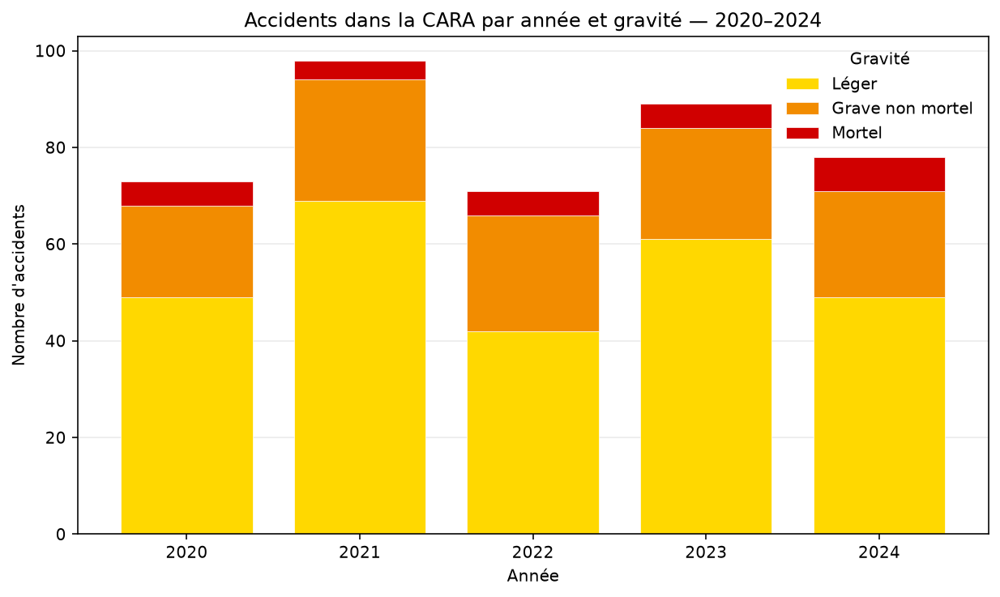
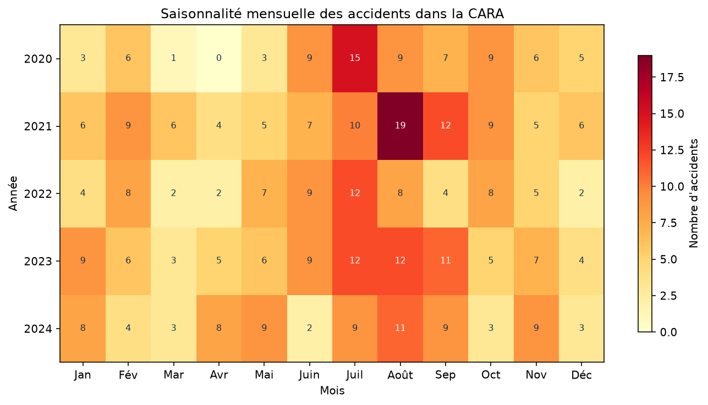
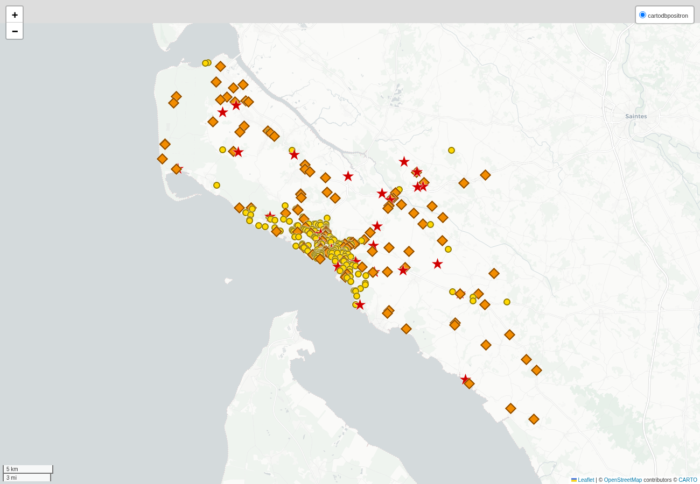

# Accidentologie

Bibliothèque Python pour télécharger, filtrer, analyser et visualiser les bases
annuelles des accidents corporels de la circulation routière (BAAC).

L'interface est conçue autour de trois principes :

1. une ligne par accident dans le DataFrame principal ;
2. des fonctions d'analyse qui retournent des DataFrames réutilisables ;
3. des fonctions de rendu indépendantes qui retournent une figure Matplotlib ou une
   carte Folium.

Ainsi, chaque CSV et chaque graphique peut être produit séparément, puis les figures
choisies peuvent être assemblées dans un rapport PDF.

## Installation

Le projet nécessite Python 3.10 ou une version plus récente.

```bash
git clone https://github.com/bbodin/accidentologie.git
cd accidentologie
python -m venv .venv
source .venv/bin/activate
python -m pip install -e .
```

## Exemple rapide

```python
from accidentologie import (
    get_dataframe,
    plot_accident_per_year,
    plot_severity_map,
)

accidents = get_dataframe(
    years=[2022, 2023, 2024],
    communes=["17015", "17021", "17306"],
)

ax = plot_accident_per_year(accidents)
ax.figure.savefig("accidents_par_annee.png", dpi=180, bbox_inches="tight")

carte = plot_severity_map(accidents, output="carte.html")
```

Les communes sont identifiées par leur code INSEE à cinq caractères, et non par leur
code postal.



*Nombre d'accidents par gravité dans la CARA, de 2020 à 2024.*

## Notebook de démonstration

Le notebook [`notebooks/accidentologie_demo.ipynb`](notebooks/accidentologie_demo.ipynb)
analyse la CARA de 2020 à 2024. Il présente le chargement des accidents et des usagers,
les agrégations avec Pandas et les visualisations suivantes :

- l'évolution mensuelle des accidents par gravité ;
- une heatmap de saisonnalité année × mois ;
- une heatmap jour de semaine × heure ;
- une pyramide des âges des victimes ;
- la part hospitalisée ou tuée selon le mode de déplacement.



*Nombre d'accidents par mois dans la CARA, de 2020 à 2024.*

Pour l'ouvrir :

```bash
python -m pip install -e ".[notebook]"
jupyter lab notebooks/accidentologie_demo.ipynb
```

La carte Folium est enregistrée dans `notebooks/outputs/`.

## Organisation

```text
accidentologie/
├── __init__.py       # interface publique
├── download.py       # téléchargement data.gouv.fr
├── data.py           # DataFrame canonique des accidents
├── analysis.py       # tableaux et DataFrame des usagers
├── clustering.py     # profils de victimes
├── plots.py          # graphiques et cartes
├── report.py         # assemblage PDF
└── territories.py    # type générique de territoire
main.py               # génération des exports et du rapport
```

`main.py` fournit une interface en ligne de commande pour créer les CSV, les images,
la carte HTML et le rapport PDF d'un territoire.

## Télécharger les CSV BAAC

```python
from accidentologie import download_csv_files

downloaded = download_csv_files(
    years=[2022, 2023, 2024],
    data_dir="data",
)

print(f"{len(downloaded)} fichiers téléchargés")
```

Chaque année contient les quatre tables officielles : `caracteristiques`, `lieux`,
`vehicules` et `usagers`. Les fichiers déjà présents ne sont pas retéléchargés.

```python
# Retéléchargement explicite
download_csv_files(years=2024, force=True)

# Sans affichage de progression, par exemple dans une application web
download_csv_files(years=2024, progress=None)
```

Avec l'interface en ligne de commande :

```bash
python main.py --download
```

## Définir un territoire

Un territoire est simplement un nom et une liste de codes INSEE communaux.

```python
from accidentologie import Territory

secteur_royan = Territory(
    "Royan et communes voisines",
    ["17306", "17333", "17380", "17461"],
)
```

La propriété `secteur_royan.communes` peut ensuite être transmise aux fonctions de
chargement. Le paramètre `communes` accepte également un code INSEE isolé ou une
liste de codes.

## Charger les accidents

`get_dataframe` retourne une ligne par accident et filtre les fichiers pendant leur
lecture afin de limiter la mémoire utilisée.

```python
from accidentologie import get_dataframe

accidents = get_dataframe(
    years=range(2020, 2025),
    communes=["17306", "17333", "17380", "17461"],
    data_dir="data",
)
```

Passer `None` sélectionne toutes les années présentes ou toute la France :

```python
france = get_dataframe(years=2024, communes=None)
toutes_les_annees = get_dataframe(years=None, communes="17306")
```

### Colonnes principales

| Colonne | Description |
|---|---|
| `accident_id` | identifiant BAAC unique |
| `year`, `date`, `time` | date et heure normalisées |
| `department_code`, `commune_code` | codes géographiques |
| `address` | adresse déclarée |
| `latitude`, `longitude`, `has_coordinates` | géolocalisation disponible |
| `severity_code`, `severity` | conséquence la plus grave de l'accident |
| `number_killed` | personnes tuées |
| `number_hospitalized` | blessés hospitalisés |
| `number_slightly_injured` | blessés légers |
| `number_users`, `number_vehicles` | usagers et véhicules enregistrés |
| `vehicle_codes`, `vehicle_types` | catégories de véhicules impliquées |

La gravité est exclusive : un accident mortel n'est pas également compté comme grave
ou léger. Les codes communaux de l'ancien schéma 2005–2018 sont normalisés au format
INSEE à cinq caractères.

## Produire les tableaux CSV

Les fonctions d'analyse retournent des DataFrames ordinaires.

```python
from accidentologie import (
    export_csv,
    get_accidents_per_year,
    get_vehicle_severity_table,
    get_victim_dataframe,
    get_fatalities_by_user_type,
)

par_annee = get_accidents_per_year(accidents)
par_vehicule = get_vehicle_severity_table(accidents)

usagers = get_victim_dataframe(
    years=[2022, 2023, 2024],
    communes=["17306", "17333", "17380", "17461"],
)
tues = get_fatalities_by_user_type(usagers)

export_csv(accidents, "exports/accidents.csv")
export_csv(par_annee, "exports/accidents_par_annee.csv")
export_csv(par_vehicule, "exports/accidents_par_vehicule.csv")
export_csv(usagers, "exports/usagers.csv")
export_csv(tues, "exports/tues_par_type_usager.csv")
```

`get_vehicle_severity_table` compte un accident une fois pour chaque type de véhicule
distinct impliqué. Le total par véhicule n'est donc pas nécessairement le nombre
d'accidents uniques.

## Générer les graphiques individuellement

Chaque fonction retourne un axe Matplotlib. Sa figure peut être affichée dans un
notebook, enregistrée ou insérée dans une interface.

```python
from accidentologie import (
    plot_accident_per_year,
    plot_vehicle_severity_table,
    plot_fatalities_by_user_type,
    plot_severity_map_static,
)

ax_year = plot_accident_per_year(
    accidents,
    title="Accidents — Royan et communes voisines",
)
ax_year.figure.savefig("plots/par_annee.png", dpi=180, bbox_inches="tight")

ax_vehicle = plot_vehicle_severity_table(par_vehicule)
ax_vehicle.figure.savefig("plots/par_vehicule.png", dpi=180, bbox_inches="tight")

if not tues.empty:
    ax_fatalities = plot_fatalities_by_user_type(tues)

ax_map = plot_severity_map_static(accidents)
ax_map.figure.savefig("plots/carte.png", dpi=180, bbox_inches="tight")
```

## Générer la carte interactive

```python
from accidentologie import plot_severity_map

carte = plot_severity_map(
    accidents,
    output="carte_interactive.html",
    cluster=False,
)
```

La fonction retourne un objet `folium.Map`. Les accidents mortels sont des étoiles
rouges, les graves non mortels des losanges orange et les légers des ronds jaunes.
La limite par défaut de 20 000 points peut être modifiée avec `max_points`.
Avec `cluster=False`, chaque accident est affiché séparément ; `cluster=True` regroupe
les marqueurs proches.



*Accidents géolocalisés dans la CARA, de 2020 à 2024.*

## Clustering des profils de victimes

```python
from accidentologie import (
    cluster_victims,
    plot_cluster_profiles,
    plot_clustering_diagnostic,
)

result = cluster_victims(usagers)

print(result.selected_clusters)
print(result.profiles)
print(result.diagnostics)

ax_profiles = plot_cluster_profiles(result.profiles)
ax_diagnostic = plot_clustering_diagnostic(result.diagnostics)

export_csv(result.profiles, "exports/clusters_profils.csv")
export_csv(result.victims, "exports/usagers_avec_cluster.csv")
export_csv(result.diagnostics, "exports/clusters_diagnostic.csv")
```

Le clustering utilise une distance de Gower et une classification hiérarchique à
lien complet. Il compare par défaut 2 à 20 groupes et écarte les solutions contenant
des microgroupes ou insuffisamment stables.

## Générer un rapport PDF

```python
from accidentologie import save_pdf_report

figures = [
    ax_year.figure,
    ax_vehicle.figure,
    ax_map.figure,
    ax_profiles.figure,
    ax_diagnostic.figure,
]

save_pdf_report(
    figures,
    "rapport.pdf",
    title="Rapport d'accidentologie — Royan et communes voisines",
)
```

L'ordre des figures dans la liste détermine l'ordre des pages du rapport.

## Utiliser `main.py`

### Générer le rapport PDF de la CARA

`main.py` utilise par défaut les 33 communes de la CARA. Pour télécharger les données
manquantes, produire tous les CSV et graphiques, puis générer le rapport :

```bash
python main.py --download
```

Si les CSV BAAC sont déjà présents dans `data/`, le téléchargement peut être omis :

```bash
python main.py
```

Ces commandes analysent les 33 communes de la CARA sur la période 2005–2024. Le
graphique des personnes tuées porte sur 2023 et 2024, les deux dernières années de
la sélection. Le PDF est créé ici :

```text
outputs/communaute-d-agglomeration-royan-atlantique-cara/rapport.pdf
```

Pour indiquer explicitement la période et les années du graphique des personnes
tuées :

```bash
python main.py \
  --years 2005 2006 2007 2008 2009 2010 2011 2012 2013 2014 \
          2015 2016 2017 2018 2019 2020 2021 2022 2023 2024 \
  --fatality-years 2023 2024
```

Le rapport peut aussi être construit avec l'API Python :

```python
from accidentologie import (
    Territory,
    cluster_victims,
    get_dataframe,
    get_fatalities_by_user_type,
    get_vehicle_severity_table,
    get_victim_dataframe,
    plot_accident_per_year,
    plot_cluster_profiles,
    plot_clustering_diagnostic,
    plot_fatalities_by_user_type,
    plot_severity_map_static,
    plot_vehicle_severity_table,
    save_pdf_report,
)

cara = Territory(
    "Communauté d'agglomération Royan Atlantique (CARA)",
    [
        "17015", "17021", "17034", "17060", "17064", "17068", "17079",
        "17098", "17119", "17131", "17152", "17155", "17160", "17183",
        "17151", "17452", "17097", "17225", "17228", "17230", "17247",
        "17248", "17306", "17307", "17311", "17333", "17380", "17393",
        "17409", "17421", "17425", "17437", "17461",
    ],
)
years = range(2005, 2025)
accidents = get_dataframe(years=years, communes=cara.communes)
usagers = get_victim_dataframe(years=years, communes=cara.communes)

vehicules = get_vehicle_severity_table(accidents)
tues = get_fatalities_by_user_type(usagers, years=[2023, 2024])
clusters = cluster_victims(usagers)

figures = [
    plot_accident_per_year(
        accidents,
        title=f"Accidents par année et gravité — {cara.name}",
    ).figure,
    plot_vehicle_severity_table(
        vehicules,
        title=f"Accidents par véhicule et gravité — {cara.name}",
    ).figure,
    plot_fatalities_by_user_type(
        tues,
        title=f"Personnes tuées par type d'usager — {cara.name}",
    ).figure,
    plot_severity_map_static(
        accidents,
        title=f"Accidents géolocalisés — {cara.name}",
    ).figure,
    plot_cluster_profiles(
        clusters.profiles,
        title=f"Profils de victimes — {cara.name}",
    ).figure,
    plot_clustering_diagnostic(
        clusters.diagnostics,
        title=f"Choix du nombre de profils — {cara.name}",
    ).figure,
]

save_pdf_report(
    figures,
    "rapport_cara.pdf",
    title=f"Rapport d'accidentologie — {cara.name}",
)
```

Les résultats sont écrits dans `outputs/<territoire>/` :

```text
csv/                    # toutes les tables exportables
plots/                  # chaque graphique en PNG
carte_interactive.html  # carte Folium
rapport.pdf             # figures assemblées
```

### Rapport pour une autre ville

Royan, pour 2015–2024 :

```bash
python main.py \
  --territory-name "Royan" \
  --communes 17306 \
  --years 2015 2016 2017 2018 2019 2020 2021 2022 2023 2024
```

Plusieurs communes :

```bash
python main.py \
  --territory-name "Côte de Beauté" \
  --communes 17306 17333 17380 17461 \
  --years 2020 2021 2022 2023 2024 \
  --fatality-years 2023 2024 \
  --download
```

Le graphique des personnes tuées porte par défaut sur les deux dernières années de
la sélection ; le CSV conserve toutes les années. `--fatality-years` permet de choisir
explicitement les années du graphique.

Pour un petit territoire où le clustering serait peu pertinent :

```bash
python main.py --territory-name "Royan" --communes 17306 --skip-clustering
```

## Utilisation dans une application web

- `download_csv_files(..., progress=None)` convient à une tâche d'arrière-plan ;
- les DataFrames peuvent être sérialisés en CSV avec `export_csv` ou directement en
  JSON avec Pandas ;
- les figures Matplotlib peuvent être écrites dans un `BytesIO` ;
- `plot_severity_map` retourne le HTML Folium via `carte.get_root().render()` ;
- `save_pdf_report` accepte n'importe quelle sélection de figures.

Graphique en mémoire :

```python
from io import BytesIO

buffer = BytesIO()
ax = plot_accident_per_year(accidents)
ax.figure.savefig(buffer, format="png", dpi=160, bbox_inches="tight")
buffer.seek(0)
```

## Limites des données

- La géolocalisation est très incomplète avant 2013. Les comptages restent valides,
  mais la carte ne représente que les accidents disposant de coordonnées.
- Les changements et fusions de communes ne sont pas reconstruits automatiquement.
- Les catégories BAAC ont évolué ; les anciennes catégories restent explicitement
  libellées.
- Sans population exposée, trafic ou kilométrage parcouru, les résultats décrivent
  les accidents observés et non un risque individuel absolu.

## Source et licence

Données : Ministère de l'Intérieur — bases annuelles BAAC publiées sur
[data.gouv.fr](https://www.data.gouv.fr/datasets/bases-de-donnees-annuelles-des-accidents-corporels-de-la-circulation-routiere-annees-de-2005-a-2024).

Le code du projet est sous licence MIT.
